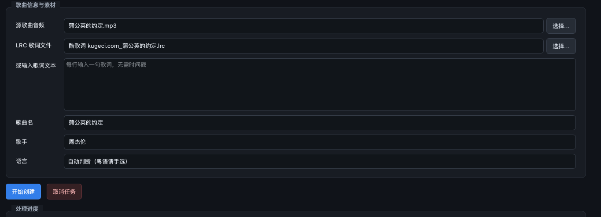
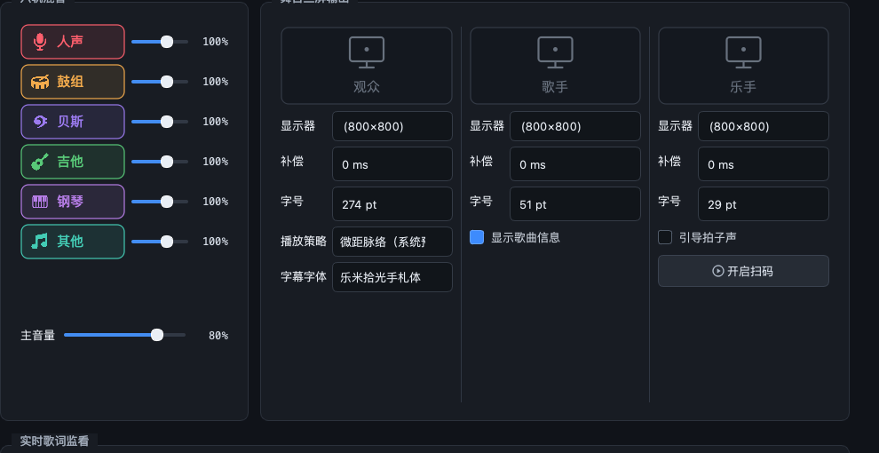
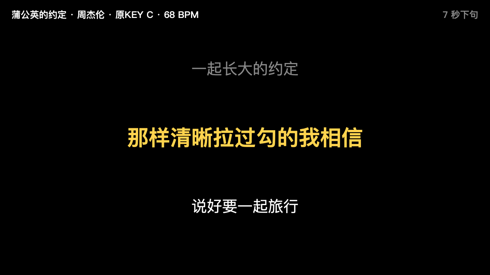
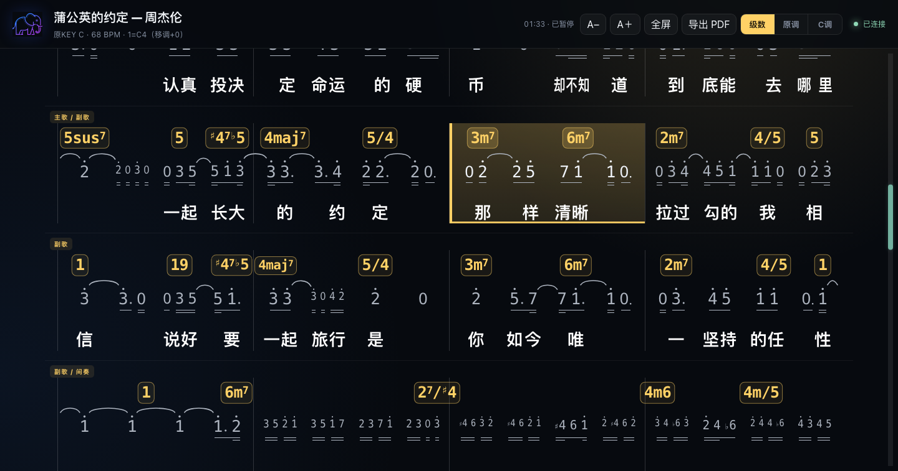

# DX Band · Music Production and Live Performance Workstation

**English** | [简体中文](README.zh-CN.md)

DX Band is a local application for creating songs and running live performances. It supports six-stem audio separation, lyric transcription and editing, beat and chord analysis, playlists, and separate audience, singer, and musician screens. The desktop app uses Python and PySide6 and has been tested on macOS with Apple Silicon.

Original DX Band source code is licensed under [GPL-3.0-only](LICENSE). Third-party resources and models have their own licenses; see the [resource license notes](LICENSING.md) and [model notices](MODEL_NOTICES.md).

Website: [www.dx-band.site](https://www.dx-band.site/)

## Features

- Create songs from MP3, AAC, or WAV files and separate vocals, drums, bass, guitar, piano, and other instruments.
- Import LRC lyrics or enter them line by line, then transcribe, align words, and correct the results manually.
- Analyze beats, measures, melody, and chords, and show a score on the musician screen.
- Adjust the volume or mute state of each of the six stems independently, and change playback speed to a target BPM.
- Open the singer and musician screens in local windows or connect phones and tablets over a local network.
- Choose from three original looping background videos included with the repository for the audience screen.
- Import and export ZIP song packages. The song library stays on the user's device.

## Screenshots and demo

Song creation screen:



Six-stem mixing and multiple-screen settings. Click the screenshot to watch the [demo video](docs/assets/dx-band-demo.mp4) included in this repository (19 seconds, no audio):

[](docs/assets/dx-band-demo.mp4)

### Three-screen output

These are actual screen images featured on the project website.

**Audience screen**


**Singer screen**



**Musician screen**



## Installer (macOS Apple Silicon)

Download `DX-Band-*-macos-arm64.dmg` from GitHub Releases, open it, and drag **DX Band** into Applications. The installer does not include AI model weights; before creating songs, open **Settings** in the app and download the models you need by role.

If FFmpeg/ffprobe is missing, download it from **Settings → Runtime Tools** in the app, or install it yourself (for example `brew install ffmpeg`). Unsigned builds may require Open Anyway under System Settings → Privacy & Security on first launch.

Maintainers can run `./scripts/build_macos_release.sh` from the repository root to produce the `.dmg`. Pushing a `v*` tag triggers GitHub Actions to build and upload only that `.dmg` to the Release.

## Run from source

You need Python 3.11 or 3.12, [uv](https://docs.astral.sh/uv/), and FFmpeg/ffprobe. Run these commands from the project root, where `pyproject.toml` is located:

```bash
brew install ffmpeg
uv sync --extra ai --extra dev
uv run dx-band
```

If FFmpeg is already installed, skip `brew install ffmpeg`. For later launches, run `uv run dx-band` from the project root.

To create songs, obtain the required AI models from their original providers and place them on your computer. Model weights are not included in this repository or in the installer. In the desktop app Settings page you can check readiness by role and download locally, or follow the [model setup guide](docs/model_self_setup.md) (Chinese). Basic tests and playback of existing songs do not require model downloads.

## Usage notes

In the song library, select a song and click **修改** (Edit) to correct lyrics, adjust timing, and edit chords. Both tabs use the same **保存修改** (Save Changes) action. The **歌手** (Singer) and **乐手** (Musician) buttons on the playback screen open local output windows. When **扫码** (QR code sharing) is enabled, phones and tablets on the same local network can scan a code to open the corresponding page. The web pages stay in sync with playback, pauses, seeking, and song changes.

The singer and musician screens use ports `8766` and `8765`, respectively. Devices on the local network that know the links can open those pages; make sure the venue network allows devices to reach one another. Get a new QR code or link if your computer's local network address changes.

The default song library is at `~/Music/DXBandLibrary`. Desktop logs are at `~/Library/Logs/DXBand/application.log`. Keep user songs, models, and runtime caches outside the source repository.

## Contact and support

For bug reports, collaboration, or licensing inquiries, email [86623634@qq.com](mailto:86623634@qq.com) or scan the WeChat customer service code below.


DX Band's original code may be used under [GPL-3.0-only](LICENSE), including for commercial purposes. To discuss different commercial license terms for code owned by DX Band, contact us using the details above. Third-party models, weights, and materials remain subject to their respective owners' licenses; DX Band cannot license them on those owners' behalf.

Voluntary donations help maintain the project. Please contact us using the details above for donation options.

The following donors' names or nicknames are published with their consent:

| Nickname | Amount |
| --- | ---: |
| 节拍旅人 | ¥100.00 |
| 捕手 | ¥88.00 |
| 星夜 | ¥66.66 |
| 低音漫游者 | ¥50.00 |
| 小节线 | ¥40.00 |
| 七和弦 | ¥30.00 |
| 排练室的灯 | ¥25.00 |
| 晚风 | ¥20.00 |
| 木吉他日记 | ¥18.88 |
| 藏在谱里的猫 | ¥16.66 |
| 四四拍 | ¥12.00 |
| 小熊 | ¥10.00 |
| 月光钢琴 | ¥8.88 |
| 回声计划 | ¥5.00 |
| 未完成的副歌 | ¥3.33 |
| 第一拍 | ¥1.66 |

## Development and verification

```bash
uv run --no-sync pytest -q tests/analysis tests/creation tests/integration tests/services tests/unit
uv run --no-sync pytest -q tests/ui
uv run --no-sync ruff check src scripts/check_open_source_resources.py scripts/beat_benchmark.py scripts/run_beat_this.py
uv run --no-sync mypy src
uv run --no-sync python scripts/check_open_source_resources.py
```

Run the two test groups separately to avoid an intermittent Qt WebEngine crash when they share a process. The default tests do not download models or perform real AI inference.

When improving beat and measure detection, use the [synthetic beat benchmark](docs/beat_benchmark.md) (Chinese) to generate reproducible samples. To inspect a model's raw notes, beats, and lyric alignment, run:

```bash
uv run python scripts/preview_raw_score.py /path/to/song.mp3 --analyze --bpm 120 --meter 4/4
```

The preview script saves its analysis beside the input audio. Use `--export-html /path/to/preview.html` to export a standalone preview. The output may contain the original audio and lyrics, so check that you have permission before sharing it.

Application code lives in `src/dxband/`, tests in `tests/`, and reusable development tools in `scripts/`. Core logic lives in `analysis/`, `audio/`, `creation/`, `lyrics/`, `models/`, and `services/`; the desktop interface lives in `ui/`. Core modules do not depend on the desktop interface. See [CONTRIBUTING.md](CONTRIBUTING.md) (Chinese) for contribution guidelines.
