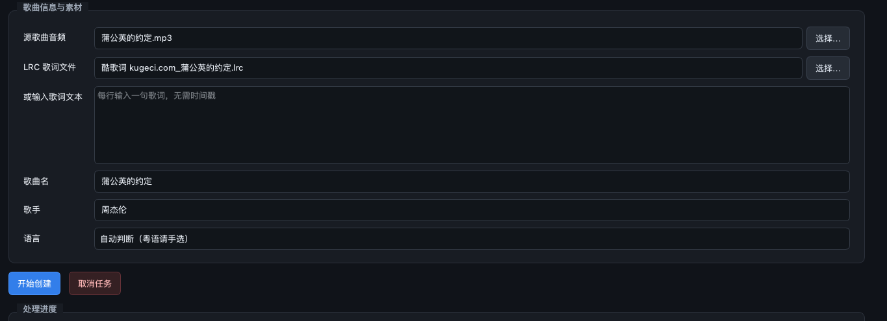
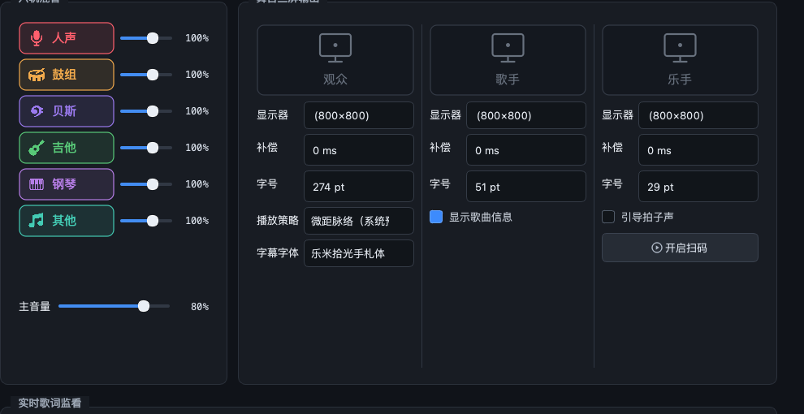
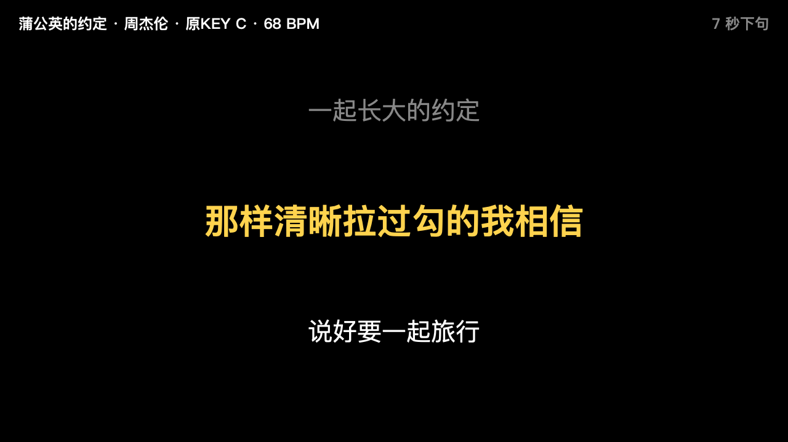
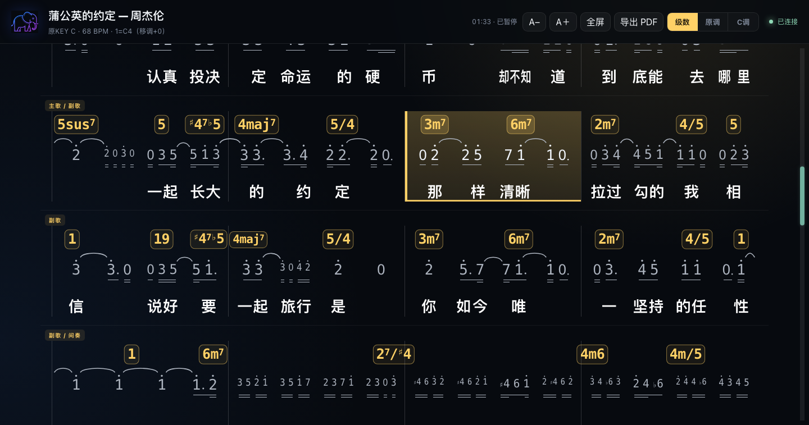

# DX Band · 大象乐队工作站

[English](README.md) | **简体中文**

DX Band 是在本机运行的歌曲制作与舞台播放程序。它支持六轨音频分离、歌词识别与校对、节拍和和弦分析、播放列表，以及观众屏、歌手屏和乐手屏输出。桌面端使用 Python 和 PySide6，已在 macOS（Apple Silicon）上验证。

项目自研源码采用 [GPL-3.0-only](LICENSE)。第三方资源和模型适用各自的许可，详见[资源许可说明](LICENSING.md)和[模型说明](MODEL_NOTICES.md)。

官网：[www.dx-band.site](https://www.dx-band.site/)

## 功能

- 从 MP3、AAC 或 WAV 创建歌曲，分离人声、鼓、贝斯、吉他、钢琴和其他音轨。
- 导入 LRC 歌词或逐行输入歌词，进行识别、逐字对齐和人工校对。
- 分析节拍、小节、旋律与和弦，在乐手屏展示谱面。
- 独立调整六轨音量和静音状态，按目标 BPM 调整播放速度。
- 将歌手屏和乐手屏显示在本机窗口，或通过局域网连接手机、平板。
- 观众屏可选用三段随仓库提供的原创循环背景视频。
- 导入和导出 ZIP 歌曲包；歌曲库保存在用户设备上。

## 界面与演示

歌曲创建界面：



六轨混音与多屏输出设置。点击截图观看仓库自带的[演示视频](docs/assets/dx-band-demo.mp4)（19 秒、无音频）：

[](docs/assets/dx-band-demo.mp4)

### 三屏输出

以下是项目官网展示的实际三屏画面。

**观众屏**


**歌手屏**



**乐手屏**



## 安装包（macOS Apple Silicon）

可从 GitHub Releases 下载 `DX-Band-*-macos-arm64.dmg`，打开后将 **DX Band** 拖入「应用程序」。安装包不含 AI 模型权重；首次创建歌曲前，请打开应用内「设置」，按用途下载所需模型。

若本机还没有 FFmpeg/ffprobe，可在应用「设置 → 运行组件」中一键下载；也可自行安装（例如 `brew install ffmpeg`）。未签名的安装包首次打开时，可能需在「系统设置 → 隐私与安全性」中选择仍要打开。

维护者可在仓库根目录执行 `./scripts/build_macos_release.sh` 本地打出 `.dmg`。推送 `v*` 标签时，GitHub Actions 会自动构建并只上传该 `.dmg` 到 Release。

## 本机运行（源码）

需要 Python 3.11 或 3.12、[uv](https://docs.astral.sh/uv/) 和 FFmpeg/ffprobe。请在包含 `pyproject.toml` 的项目根目录执行：

```bash
brew install ffmpeg
uv sync --extra ai --extra dev
uv run dx-band
```

在已经安装 FFmpeg 的系统上，可以跳过 `brew install ffmpeg`。日常启动只需在项目根目录运行 `uv run dx-band`。

创建歌曲所需的 AI 模型由使用者从原站取得并放在本机；仓库与安装包均不提供模型权重。可在应用「设置」页按用途查看就绪状态并下载，也可按[用户自备模型指南](docs/model_self_setup.md)手动配置。基础测试和播放现有歌曲不需要下载模型。

## 使用提示

在“歌曲库”选择歌曲后点击“修改”，可以校对歌词、调整时间和编辑和弦；两个标签共用“保存修改”。播放控制页的“歌手”和“乐手”按钮可打开本机输出窗口。开启“扫码”后，同一局域网内的手机或平板可扫描二维码查看对应页面。网页会跟随播放、暂停、跳转和切歌同步更新。

歌手屏和乐手屏分别使用端口 `8766`、`8765`。局域网中知道链接的设备可以查看相应页面；使用时请确认场地网络允许设备互访。电脑的局域网地址变化后，请重新获取二维码或链接。

默认歌曲库位于 `~/Music/DXBandLibrary`。桌面日志位于 `~/Library/Logs/DXBand/application.log`。用户歌曲、模型和运行缓存不应放入源码仓库。

## 联系与支持

问题反馈、合作咨询和授权洽谈可发送邮件至 [86623634@qq.com](mailto:86623634@qq.com)，或扫描下方二维码联系微信客服。


DX Band 自研代码可依 [GPL-3.0-only](LICENSE) 条款使用，包括商业使用。若需要就 DX Band 拥有版权的代码商谈其他商业授权条款，请通过上述方式联系我们。第三方模型、权重和素材须分别遵守其权利人的许可，DX Band 无法代为授权。

欢迎自愿捐赠，支持项目维护。捐赠方式请通过上述联系方式咨询。

以下是部分名单**捐赠者的姓名或昵称只会在征得本人同意后公开**

| 昵称 | 金额 |
| --- | ---: |
| 节拍旅人 | ¥100.00 |
| 捕手 | ¥88.00 |
| 星夜 | ¥66.66 |
| 低音漫游者 | ¥50.00 |
| 小节线 | ¥40.00 |
| 七和弦 | ¥30.00 |
| 排练室的灯 | ¥25.00 |
| 晚风 | ¥20.00 |
| 木吉他日记 | ¥18.88 |
| 藏在谱里的猫 | ¥16.66 |
| 四四拍 | ¥12.00 |
| 小熊 | ¥10.00 |
| 月光钢琴 | ¥8.88 |
| 回声计划 | ¥5.00 |
| 未完成的副歌 | ¥3.33 |
| 第一拍 | ¥1.66 |

## 开发与验证

```bash
uv run --no-sync pytest -q tests/analysis tests/creation tests/integration tests/services tests/unit
uv run --no-sync pytest -q tests/ui
uv run --no-sync ruff check src scripts/check_open_source_resources.py scripts/beat_benchmark.py scripts/run_beat_this.py
uv run --no-sync mypy src
uv run --no-sync python scripts/check_open_source_resources.py
```

两组测试分开运行，以避免 Qt WebEngine 在同一测试进程中偶发崩溃。默认测试不下载模型，也不执行真实 AI 推理。

改进节拍和小节线算法时，可使用[合成节拍基准](docs/beat_benchmark.md)生成可复现样本。需要查看模型原始音符、拍点与歌词对齐结果时，可运行：

```bash
uv run python scripts/preview_raw_score.py /path/to/song.mp3 --analyze --bpm 120 --meter 4/4
```

预览脚本会在输入音频旁保存分析结果。用 `--export-html /path/to/preview.html` 可导出单页预览；输出可能包含原始音频和歌词，分享前请确认有权公开。

项目使用 `src/dxband/` 存放程序代码，`tests/` 存放测试，`scripts/` 存放可重复使用的开发工具。核心业务逻辑位于 `analysis/`、`audio/`、`creation/`、`lyrics/`、`models/` 和 `services/`；桌面界面位于 `ui/`。核心模块不依赖桌面界面。贡献方式见 [CONTRIBUTING.md](CONTRIBUTING.md)。
